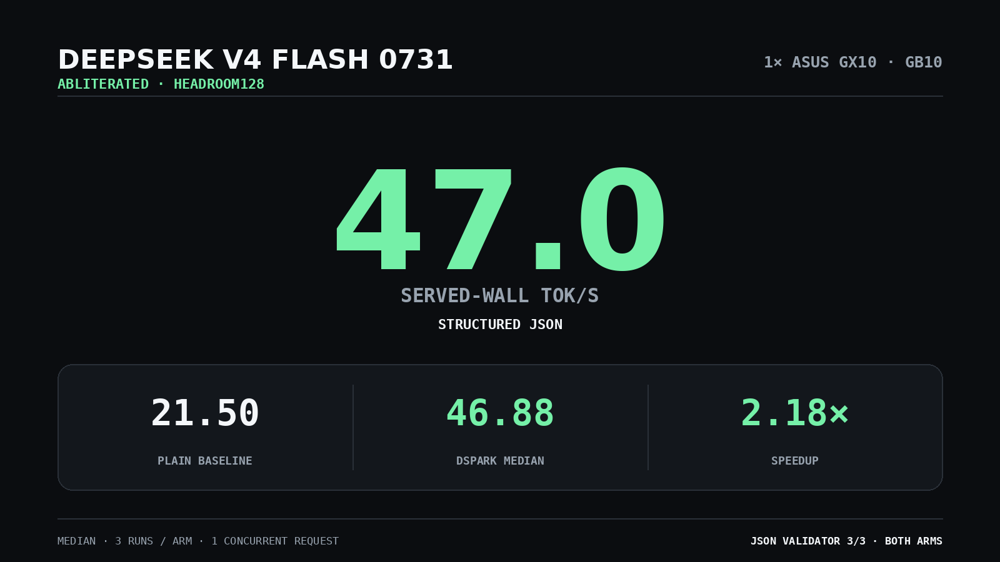

# DeepSeek V4 Flash 0731 Abliterated at 47 tok/s on one GX10



**Best measured result: 46.88 served-wall tok/s median, rounded to 47 tok/s, versus a 21.50 tok/s plain baseline. That is 2.18x faster.**

The comparison uses the exact same abliterated Headroom128 checkpoint, Entrpi `ds4` runtime, request payloads, sampler, and hardware. The only treatment is DSpark speculative decoding.

## Result

| | Plain baseline | DSpark |
|---|---:|---:|
| Median served-wall throughput | 21.50 tok/s | **46.88 tok/s** |
| Three measured runs | 21.52, 21.50, 21.50 | **46.88, 46.69, 47.03** |
| Structured-output validator | 3/3 passed | **3/3 passed** |

- Hardware: one ASUS GX10 with NVIDIA GB10
- Workload: structured JSON generation
- Concurrency: one request
- Repetitions: three measured runs per arm after warm-up
- Sampling: temperature 0
- Metric: completion tokens divided by non-streaming request wall time
- Scope: served-wall throughput, not isolated kernel throughput

`47 tok/s` is the rounded median. The fastest measured run was `47.03 tok/s`.

## Exact stack

### Abliterated target

- Repository: `apetersson/DeepSeek-V4-Flash-0731-Abliterated-DS4-Headroom128`
- Revision: `08f6c6225ab4d29a735ab7d48d46bd0a3a767a07`
- File: `DeepSeek-V4-Flash-0731-Abliterated-DS4-Headroom128.gguf`
- SHA-256: `55a46e7e9a51f3d6708559b8b284c3e60f6b97f9bab1f2c9633948c8331e99ee`

### DSpark drafter

- Repository: `bleysg/DeepSeek-V4-Flash-DSpark-drafter-GGUF`
- Revision: `81c6fdd38f9582da45ba27f0ed7b63bcd3ea3b62`
- File: `DSpark-drafter-Q2K-Q8-0731.gguf`
- SHA-256: `8fa269560dc76fd73e4233ad9b1938b5f65dd363381fd9b1a5c6183f7d12d686`

### Runtime

- Repository: `Entrpi/ds4`
- Revision: `d183482b413ecd2e3b540b290e6497437e9fbb73`
- Version: `v0.6.2`
- Build: `make cuda-spark`
- Backend: CUDA `sm_121`
- Context: `32,768`
- Continuous banks: `2`
- Prefill chunk: `1,024`

The target produced every final token. The drafter only proposed candidates that the target accepted or rejected.

## Reproduce

Build the pinned runtime:

```bash
git clone https://github.com/Entrpi/ds4.git
cd ds4
git checkout --detach d183482b413ecd2e3b540b290e6497437e9fbb73
make cuda-spark
```

Set the three pinned paths and start the DSpark arm:

```bash
export DS4_RUNTIME_DIR=/path/to/ds4
export DS4_MODEL_PATH=/path/to/DeepSeek-V4-Flash-0731-Abliterated-DS4-Headroom128.gguf
export DS4_DRAFTER_PATH=/path/to/DSpark-drafter-Q2K-Q8-0731.gguf
./scripts/serve.sh dspark
```

Run the frozen benchmark:

```bash
python3 scripts/bench.py \
  --arm dspark_v062 \
  --base-url http://127.0.0.1:8001 \
  --fixtures protocol/fixtures.json \
  --out run/dspark \
  --repeats 3
```

Use `./scripts/serve.sh plain` for the matched `--no-spec` baseline.

## Evidence

- [`results/analysis.json`](results/analysis.json): complete machine-readable result, including all frozen fixtures
- [`RESULTS.md`](RESULTS.md): focused 47 tok/s result and scope
- [`protocol/PROTOCOL.json`](protocol/PROTOCOL.json): frozen matched protocol
- [`protocol/fixtures.json`](protocol/fixtures.json): exact prompts and validator manifest
- [`scripts/bench.py`](scripts/bench.py): request collector and deterministic validators
- [`scripts/serve.sh`](scripts/serve.sh): hash-pinned launcher
- [`results/deployment-qualification.json`](results/deployment-qualification.json): live deployment qualification

The headline reports the best measured fixture result. The complete four-fixture matrix remains available in `results/analysis.json` rather than being converted into a broader universal throughput claim.

## Sources

- [Entrpi/ds4](https://github.com/Entrpi/ds4)
- [Entrpi/ds4-on-spark](https://github.com/Entrpi/ds4-on-spark)
- [Headroom128 abliterated target](https://huggingface.co/apetersson/DeepSeek-V4-Flash-0731-Abliterated-DS4-Headroom128)
- [0731 Q2K/Q8 drafter](https://huggingface.co/bleysg/DeepSeek-V4-Flash-DSpark-drafter-GGUF)
